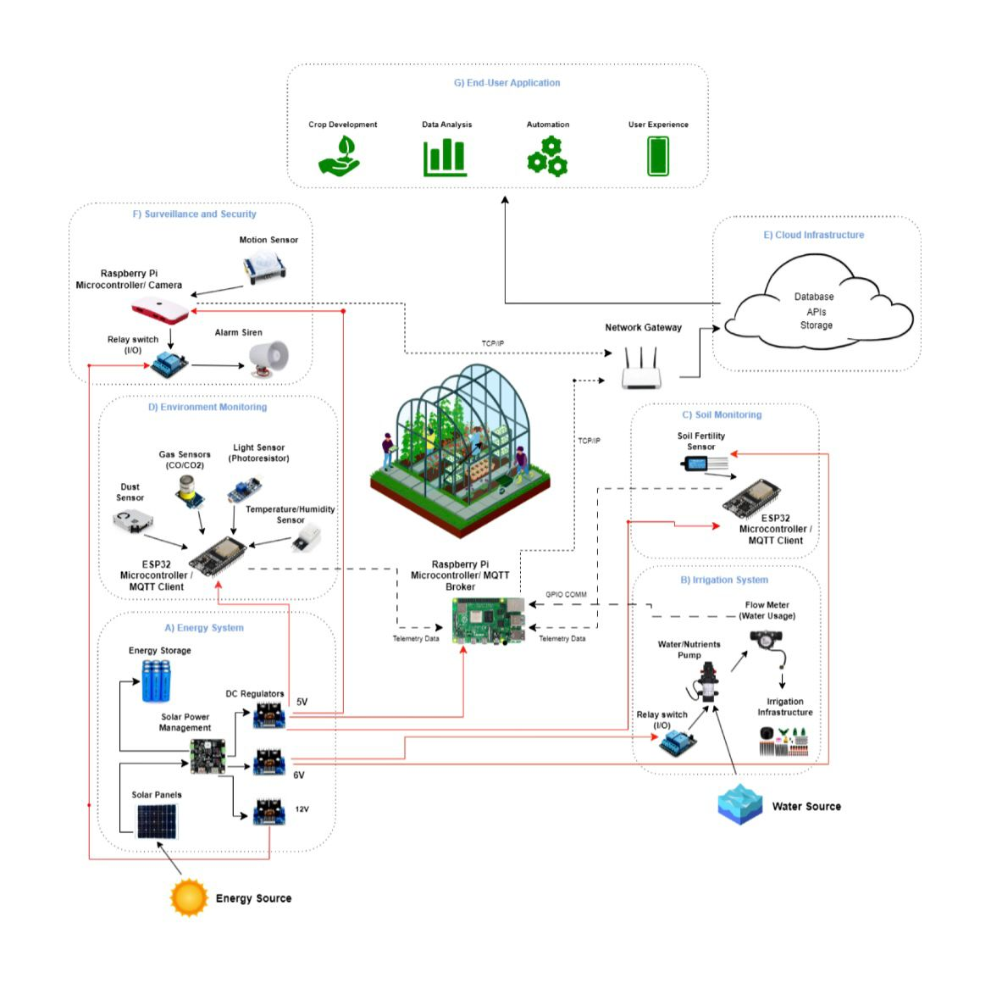
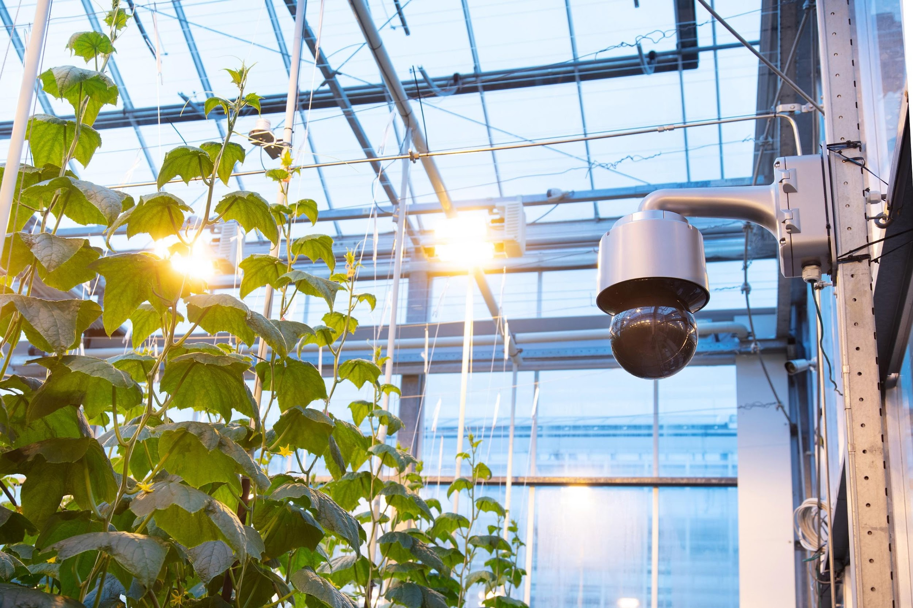

# Group 7 – Surveillance System

**Greenhouse Crop Surveillance and Monitoring System (GCSMS)**  
_“Protecting your space, one alert at a time.”_

`Information Systems 353` · `Group project, 2024` · `ARC Bien Donne farm` · `ESP32 / IoT prototype`

> Academic capstone prototype from 2024. It demonstrates a low-cost IoT security system; it is not a production security product.

---

## Overview

This repository contains the firmware for the **Group 7 surveillance subsystem** of the 2024 IFS 353 smart-farming group project. The client was the Agricultural Research Council (ARC) at the Bien Donne farm, and the wider class project combined several subsystems (irrigation, soil, climate, energy/network, data management and end-user experience) into one farm-management ecosystem.

Group 7 built a surveillance system to protect greenhouse crops, equipment and technological assets from theft, vandalism and wildlife interference. The same hardware also doubles as a growth-monitoring tool: cameras positioned above plant beds capture images of worker activity and crop development that can be reviewed later in the ARC app.

When the system is armed and a PIR sensor detects movement, the ESP32-CAM captures photos and uploads them to Firebase Storage, while an ESP32 development module activates a siren and sends an email alert to the farm manager. A Raspberry Pi Zero provides a live video stream through MotionEye OS and an ngrok tunnel.

## Problem and solution

| Pain point identified by the client | What this subsystem does about it |
| --- | --- |
| Theft of crops and equipment, often while the farm is unmonitored (nights / off-hours) | PIR-triggered image capture, cloud image gallery, email notification and a relay-driven siren; a physical toggle switch arms and disarms the system. |
| Difficulty monitoring agricultural practices (watering, chemical application) and plant growth | A camera above the plant beds captures worker activity and periodic images of new crops; images are viewable in the app. |
| Common security solutions (guards, fencing, insurance, tracking) are expensive | Low-cost ESP32 boards, a PIR sensor, a relay and a Raspberry Pi Zero form an affordable, expandable network. |

## Features

- **Motion-triggered capture** – a PIR sensor on GPIO 13 starts a capture session: one photo on detection and a second 15 seconds later, with the onboard flash.
- **Cloud evidence** – JPEGs are buffered in LittleFS and uploaded to Firebase Storage; local copies are deleted after a successful upload.
- **Real-time alerting** – the camera broadcasts a motion message over ESP-NOW; the ESP32 Dev module sends an SMTP email to the farm manager.
- **Audible deterrent** – a 5 V two-channel relay drives a siren for two minutes after a 30-second grace period.
- **Manual arm/disarm** – a toggle switch controls the whole subsystem. Disarming cancels capture, stops the relay and clears pending uploads.
- **Live stream** – Raspberry Pi Zero + Pi camera running MotionEye OS, with an ngrok tunnel and the stream URL stored for the ARC app.
- **Works without internet for the alarm core** – ESP-NOW handles device-to-device messages; Wi-Fi is only needed for uploads and email.

## System architecture



*Figure 1: Class-level system architecture showing where the surveillance subsystem fits (from the group project materials).*

The two ESP32 devices communicate over **ESP-NOW on channel 6**, using a broadcast address so every device can listen to every message. Two messages are exchanged: the toggle-switch state from the Dev module, and the motion-detected flag from the camera.

```text
Toggle switch ──> ESP32 Dev module ──ESP-NOW (ch. 6)──> ESP32-CAM + PIR sensor
                        │                                    │
                        ├── relay ──> siren                  ├── flash + 2 JPEGs ──> LittleFS
                        └── Wi-Fi ──> SMTP email             └── Wi-Fi ──> Firebase Storage ──> app gallery

Raspberry Pi Zero + Pi camera ──> MotionEye OS ──> ngrok tunnel ──> stream URL in database ──> ARC app
```

**Key implementation constraint:** an ESP32 cannot use ESP-NOW and Wi-Fi at the same time. Before uploading to Firebase or sending email, the firmware disconnects from ESP-NOW, connects to Wi-Fi, and then reinitialises ESP-NOW when the network task is done. This is why there are intentional waits in the capture/upload flow.

The camera confirms messages by blinking its built-in LED: **twice** when the switch is turned on (armed / upload complete) and **four times** when it is turned off (states reset).

## Hardware and circuit



*Figure 2: Surveillance circuit from the project documentation.*

| Component | Role in this subsystem |
| --- | --- |
| ESP32-CAM + OV2640 camera | PIR input, image capture and Firebase upload |
| ESP32 Dev module | Toggle input, relay control, email alerts and ESP-NOW messaging |
| BMT PIR motion sensor | Detects movement (up to 7 m, ~120°) |
| 5 V two-channel relay | Switches the siren on and off |
| Siren | Audible alert (108 dB at 1 m) |
| Toggle switch + 1 kΩ resistor | Arms / disarms the system |
| ESP32 30-pin terminal adapter | Screw-terminal connections for the Dev module |
| Raspberry Pi Zero + Pi V2 camera | Livestream via MotionEye OS |

### Pin map

Camera pins, from `CAMERA_MODEL_AI_THINKER` (AI Thinker ESP32-CAM):

| Signal | GPIO | Signal | GPIO |
| --- | --- | --- | --- |
| PWDN | 32 | Y2 | 5 |
| RESET | –1 (unused) | Y3 | 18 |
| XCLK | 0 | Y4 | 19 |
| SIOD (SDA) | 26 | Y5 | 21 |
| SIOC (SCL) | 27 | Y6 | 36 |
| VSYNC | 25 | Y7 | 39 |
| HREF | 23 | Y8 | 34 |
| PCLK | 22 | Y9 | 35 |

Other pins used by the firmware:

| Board | Function | GPIO |
| --- | --- | --- |
| ESP32-CAM | Flash LED | 4 |
| ESP32-CAM | PIR sensor input | 13 |
| ESP32 Dev module | Toggle switch input (`INPUT_PULLUP`) | 34 |
| ESP32 Dev module | Relay output | 33 |

## Repository contents

| File | Description |
| --- | --- |
| [`Esp32_Camera_code`](Esp32_Camera_code) | Firmware for the ESP32-CAM: camera init, PIR polling, photo capture to LittleFS, ESP-NOW receive/send, Wi-Fi mode switching and Firebase Storage upload. |
| [`Esp32_dev_module`](Esp32_dev_module) | Firmware for the ESP32 Dev module: reads the toggle switch, broadcasts its state, listens for motion messages, drives the relay/siren and sends SMTP email alerts. |
| [`CAMERA_MODEL_AI_THINKER`](CAMERA_MODEL_AI_THINKER) | OV2640 GPIO definitions for the AI Thinker ESP32-CAM. Copy this into your sketch as `camera_pin.h`. |

The original brief, presentation and full project documentation are separate from this repository; this README summarises the parts needed to understand and run the firmware.

## Getting started

### Prerequisites

- Arduino IDE with the **ESP32** board package installed.
- Libraries: `WiFi`, `esp_camera`, `esp_now`, `esp_mac`, `LittleFS`/`FS`, `Firebase_ESP_Client` (with `addons/TokenHelper.h`), and `ESP_Mail_Client`.
- A Firebase project with a Storage bucket and an email/password user.
- An SMTP account for alerts (a Gmail app password is safer than a real account password).
- AI Thinker ESP32-CAM board selected in the IDE. With PSRAM the camera uses UXGA; without PSRAM it falls back to SVGA.

### Flashing the boards

1. Clone this repository and open `Esp32_Camera_code` and `Esp32_dev_module` as Arduino sketches (rename them locally to `.ino` in folders of the same name; the repo keeps the original filenames).
2. Copy `CAMERA_MODEL_AI_THINKER` into the camera sketch folder as **`camera_pin.h`** — the camera code includes that file.
3. Replace every placeholder in the code with your own configuration:
   - Camera: `WIFI_SSID`, `WIFI_PASSWORD`, `API_KEY`, `USER_EMAIL`, `USER_PASSWORD`, `STORAGE_BUCKET_ID`.
   - Dev module: `ssid`, `password`, `email_sender`, `email_password`, `email_recipient`, and the sender name in the SMTP message.
4. Select the correct board and COM port, then upload each sketch to its board.
5. Open the Serial monitor at **9600 baud** to confirm setup messages (`Setup complete - System ready`, ESP-NOW init, Wi-Fi/Firebase status).

### Network and app setup

- Give the Raspberry Pi Zero a static IP, run MotionEye OS, expose port 8081 with ngrok and write the resulting URL to the database used by the app.
- Connect the ARC app to the Firebase project for the image gallery and to the stream URL for live viewing.
- For any real deployment, move credentials into a secrets file or environment configuration and keep them out of source control.

## How it behaves

| Stage | Timing / behaviour |
| --- | --- |
| Arming | After the switch turns on, the Dev module waits **60 s** before broadcasting the ON state. |
| Motion detected | Camera starts a session, sends a motion message and captures photo 1. |
| Photo 2 | Captured **15 s** after photo 1. |
| Upload wait | **30 s** after the last photo before the camera connects to Wi-Fi. |
| Upload | JPEG is written to Firebase Storage as `photo_<millis>.jpg`; local `/photo.jpg` is then deleted. |
| Relay / siren | Dev module waits **30 s** after the motion message, then energises the relay for **2 minutes** and sends the email. |
| Wi-Fi retries | Camera waits **5 s** between attempts (20 s connect timeout); email stages use short 5 s timeouts. |
| Disarming | Deletes stored images, cancels capture/upload, stops the relay immediately and restarts the camera. |

The email text changes depending on whether the relay was stopped during email processing, so the manager can tell whether the alarm completed.

## Known limitations

- This is a student prototype: ESP-NOW messages are unencrypted broadcast messages, and the checked-in code intentionally contains credential placeholders.
- Only one local JPEG path (`/photo.jpg`) is used on the camera, so a new capture overwrites the previous one until it is uploaded.
- The requirements document envisioned 24/7 streaming and alerts within 5 seconds; the implemented prototype deliberately includes 15–60 second capture, upload and relay delays.
- Firebase upload, SMTP email and livestreaming need internet access; the ESP-NOW alarm backbone does not.
- Raspberry Pi streaming and Oracle/ARC app integration were configured during the project but are not part of this firmware repository.
- No license was specified for these academic project files.

## Project context

- **Course:** Information Systems 353 – Digital Business Innovation, 2024 (group project).
- **Client:** Agricultural Research Council (ARC), Bien Donne farm.
- **Group 7 members:** Gino – Dean Martins, Buhle Mlangeni, Moosaa Salie.
- **Scope:** surveillance and growth-monitoring subsystem within the class's wider smart-farming system architecture.
